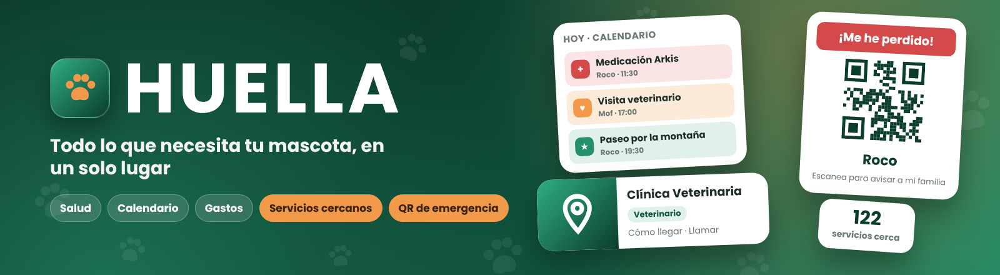
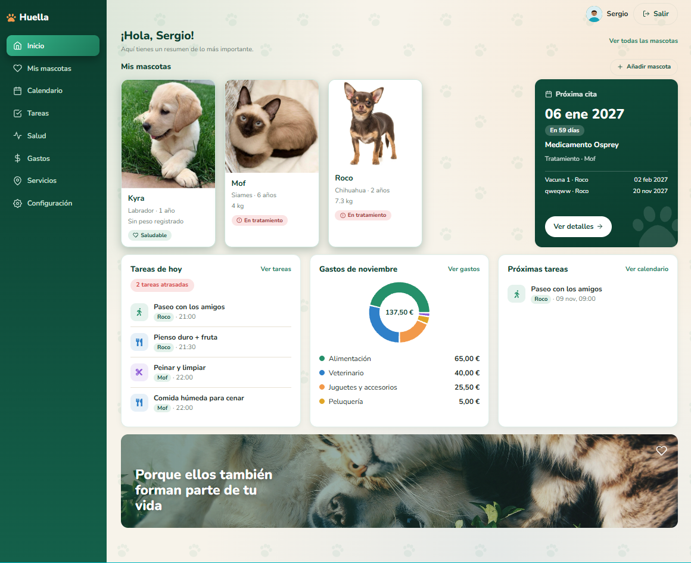
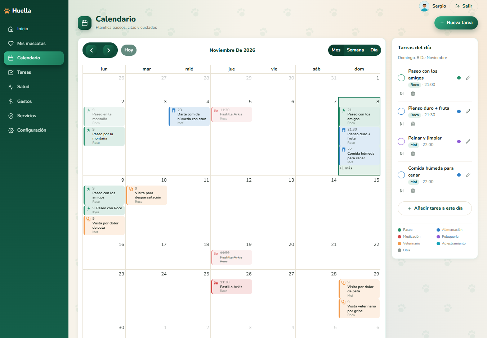
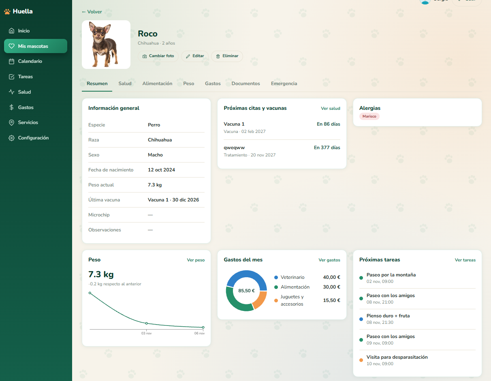
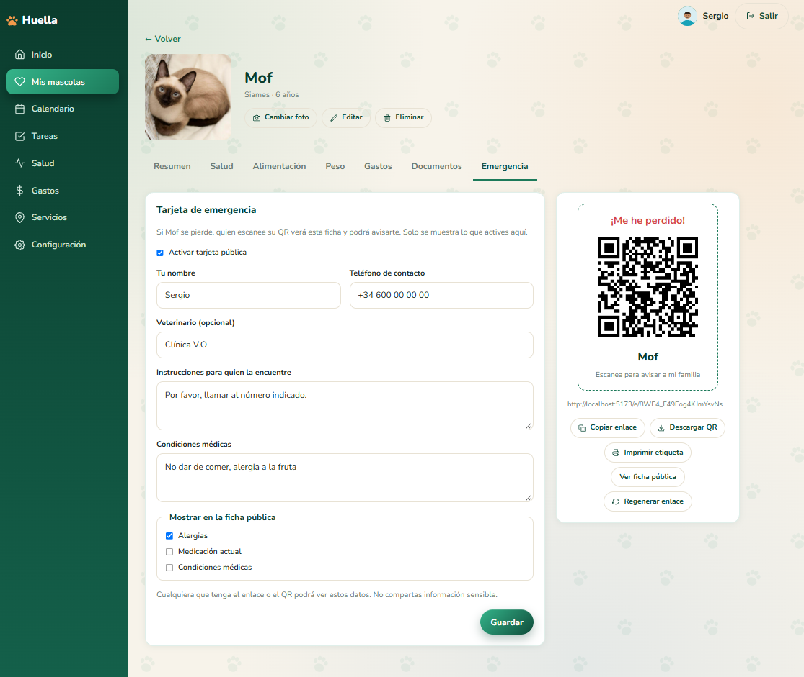
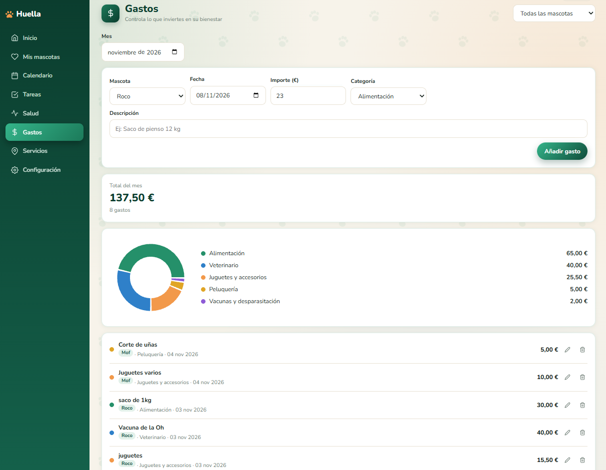
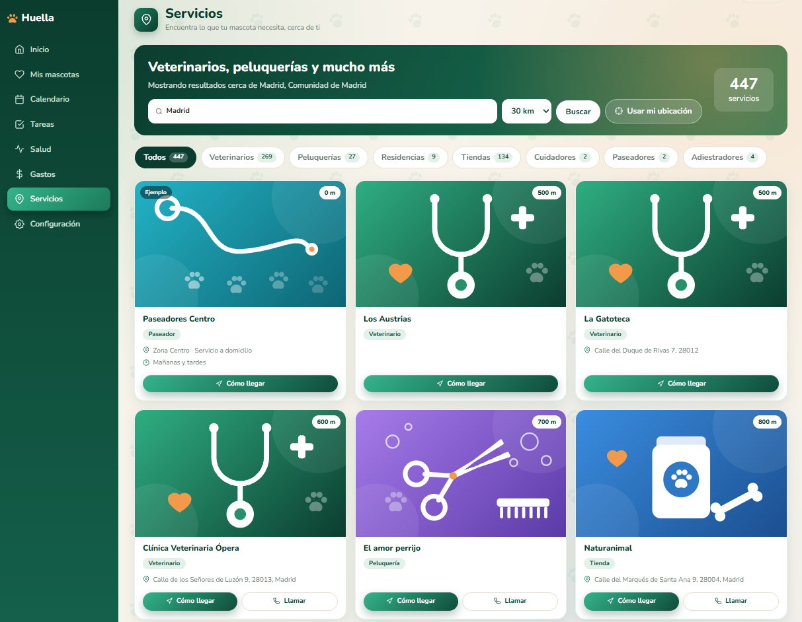
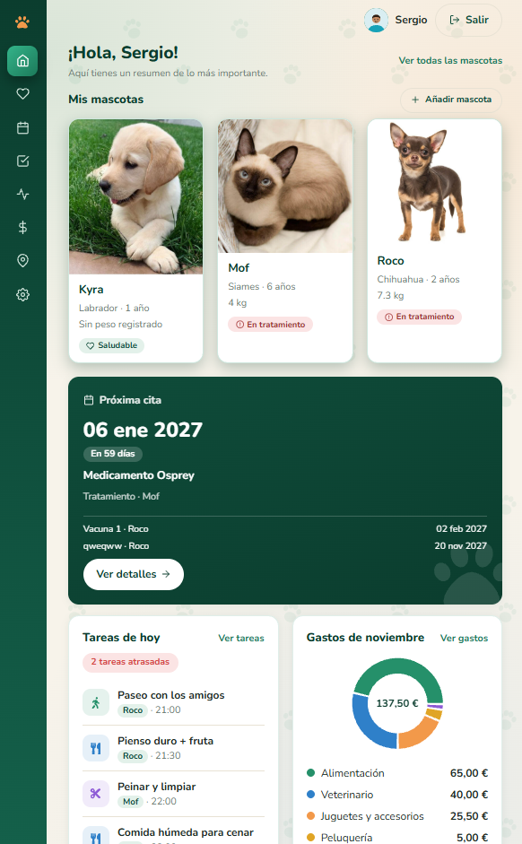

<p align="center">
  
</p>

<h1 align="center">🐾 HUELLA</h1>
<p align="center"><i>Todo lo que necesita tu mascota, en un solo lugar</i></p>

<!-- DESPLIEGUE (mañana): descomenta y pon tu URL
<p align="center">
  <a href="https://TU-URL.vercel.app">
    
  </a>
</p>

> ⏳ La API está en el plan gratuito de Render: si lleva un rato sin visitas, la primera carga puede tardar 30-50 segundos.
-->

<p align="center">
  
  
  
  
  
  
  
  
</p>

## Sobre el proyecto

**Huella** es una aplicación web full-stack para gestionar el día a día de tus mascotas:
su ficha, su salud, sus tareas, sus gastos y una **tarjeta de emergencia con código QR**
para el collar, de modo que quien la encuentre pueda avisarte al instante.

Lo he creado para practicar desarrollo full-stack de principio a fin: API REST con
autenticación por cookie, base de datos en la nube, subida de archivos, tests automáticos,
una interfaz propia y adaptada a móvil, y una página pública de aterrizaje.

## Capturas

| Inicio                        | Calendario                         | Ficha de la mascota          |
| ----------------------------- | ---------------------------------- | ---------------------------- |
|  |  |  |

| Tarjeta de emergencia              | Gastos                     | Servicios cercanos               |
| ---------------------------------- | -------------------------- | -------------------------------- |
|  |  |  |

<p align="center">
  
</p>

## Funcionalidades

- **Cuenta y sesión** con JWT en cookie `httpOnly` y contraseñas cifradas.
- **Mascotas**: ficha con foto, especie, raza, sexo, nacimiento, microchip, alergias y notas.
- **Salud**: vacunas, desparasitaciones, visitas y tratamientos, con próxima fecha y aviso de "en X días".
- **Peso**: registro histórico con gráfico de evolución.
- **Tareas y calendario**: paseos, alimentación, medicación, peluquería, veterinario y adiestramiento, con repeticiones, vista mensual, semanal y diaria, e iconos y colores por tipo.
- **Gastos**: por categoría y mascota, con resumen mensual y gráfico de donut.
- **Documentos**: informes, radiografías y análisis guardados en la nube.
- **Servicios cercanos**: buscador de veterinarios, peluquerías, residencias, tiendas, cuidadores, paseadores y adiestradores por ciudad o código postal (radio de 10 a 50 km). Muestra la distancia, abre la ruta en Google Maps y permite llamar con un toque. Usa datos abiertos de OpenStreetMap.
- **Tarjeta de emergencia**: ficha pública por mascota con **QR descargable e imprimible**. El dueño elige qué datos se muestran y quien la encuentre puede llamar con un toque, sin cuenta. El enlace se puede regenerar.
- **Inicio**: mascotas, próxima cita, tareas de hoy, gastos del mes y próximas tareas.
- **Configuración**: perfil, avatar (ocho predefinidos o foto propia) y borrado completo de la cuenta.
- **Landing pública** con redirección automática al Inicio si ya tienes sesión.
- **Responsive**: barra lateral en escritorio, iconos en tablet y menú desplegable con barra inferior en móvil.

## Tecnologías

| Parte          | Tecnologías                                                                                                 |
| -------------- | ----------------------------------------------------------------------------------------------------------- |
| Front end      | React, Vite, React Router, FullCalendar, Recharts, qrcode.react, react-icons, CSS propio (variables y grid) |
| Back end       | Node.js, Express, Mongoose, JWT, bcryptjs, helmet, CORS, límites de peticiones, Multer                      |
| Datos externos | OpenStreetMap: Nominatim (búsqueda de ciudades) y Overpass (lugares)                                        |
| Base de datos  | MongoDB Atlas                                                                                               |
| Archivos       | Cloudinary                                                                                                  |
| Tests          | Mocha, Chai, Supertest                                                                                      |

## 🌐 Despliegue

| Parte                    | Plataforma    |
| ------------------------ | ------------- |
| Front end (React + Vite) | _pendiente_   |
| API (Node + Express)     | _pendiente_   |
| Base de datos            | MongoDB Atlas |
| Archivos                 | Cloudinary    |

## Estructura

```
Huella/
├── client/     # Front end (React + Vite)   → ver client/README.md
├── server/     # API REST (Express)         → ver server/README.md
└── docs/       # Capturas e imágenes del README
```

## Puesta en marcha

Necesitas **Node.js 18+**, una base de datos en **MongoDB Atlas** (o local) y una cuenta
gratuita de **Cloudinary**.

```bash
git clone https://github.com/SergioPerez3/Huella.git
cd Huella
```

**1. Back end**

```bash
cd server
npm install
cp .env.example .env     # rellena tus claves
npm run dev              # API en http://localhost:5000
```

**2. Front end** (en otra terminal)

```bash
cd client
npm install
cp .env.example .env
npm run dev              # web en http://localhost:5173
```

Las variables de entorno de cada parte están descritas en
[`server/README.md`](server/README.md) y [`client/README.md`](client/README.md).

## API

La API cuelga de `/api/v1`. Resumen de los recursos principales:

| Recurso                       | Ruta base           | Auth    |
| ----------------------------- | ------------------- | ------- |
| Registro, login y perfil      | `/auth`             | Parcial |
| Mascotas                      | `/pets`             | Sí      |
| Tareas                        | `/tasks`            | Sí      |
| Salud (global)                | `/health-records`   | Sí      |
| Documentos (global)           | `/documents`        | Sí      |
| Gastos                        | `/expenses`         | Sí      |
| Resumen de inicio             | `/dashboard`        | Sí      |
| Servicios cercanos            | `/services`         | Sí      |
| Tarjeta de emergencia pública | `/emergency/:token` | No      |
| Comprobación de estado        | `/health`           | No      |

La documentación detallada está en [`server/README.md`](server/README.md).

## Tests

Los tests usan una base de datos aparte (`MONGO_URI_TEST`) para no tocar nunca los datos reales.

```bash
cd server
npm test
```

## Seguridad

- Contraseñas con hash y sesión en cookie `httpOnly`.
- Cada consulta filtra por propietario: un usuario nunca ve datos de otro.
- Archivos limitados a 5 MB y verificados por su contenido real, no solo por la extensión.
- La tarjeta pública solo expone los campos que el dueño activa; su enlace se puede invalidar.
- Cabeceras de seguridad con `helmet` y límite de peticiones en las rutas sensibles.
- En Servicios, las coordenadas se redondean (~1 km) y no se guardan en la base de datos. Los datos de terceros se validan antes de mostrarse (por ejemplo, solo enlaces http o https).

## Próximos pasos

- [x] API con autenticación, mascotas, salud, tareas, gastos y documentos
- [x] Tarjeta de emergencia con QR
- [x] Avatares y configuración de cuenta
- [x] Diseño responsive para móvil y tablet
- [x] Landing pública
- [x] Página de servicios cercanos con datos de OpenStreetMap
- [ ] Cuenta demo para probar la app sin registrarse
- [ ] Despliegue (front, API y base de datos)
- [ ] Modo oscuro
- [ ] Integración continua con GitHub Actions

## Autor

**Sergio Pérez Pérez** · Desarrollador full-stack junior · Madrid

[](https://github.com/SergioPerez3)

---

<p align="center">© 2026 Huella. Todos los derechos reservados.</p>
